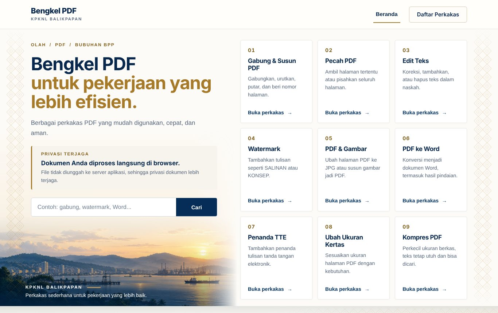
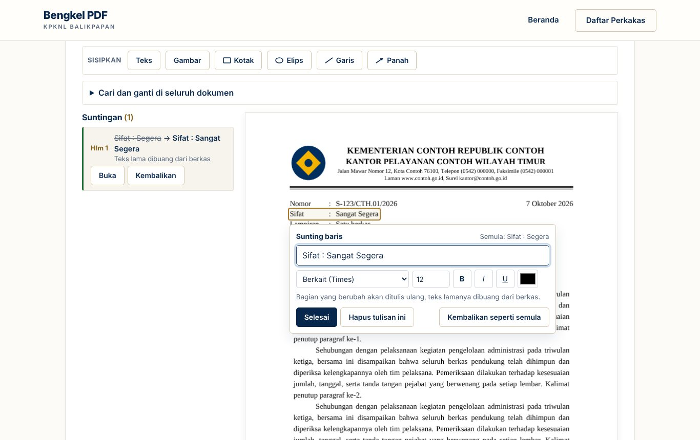

# Olah PDF

Kumpulan perkakas PDF untuk pekerjaan sehari-hari di kantor, buatan KPKNL Balikpapan. Seluruh pengolahan berjalan di peramban pengguna, jadi **berkas tidak pernah diunggah ke server mana pun**.

**Buka situsnya di [ajoedya.github.io/layananumum/bengkelpdf](https://ajoedya.github.io/layananumum/bengkelpdf/)**

## Perkakas yang tersedia

| No | Perkakas | Kegunaan |
|---|---|---|
| 01 | [Gabung/Pecah](https://ajoedya.github.io/layananumum/bengkelpdf/gabung-pecah) | Menggabungkan beberapa PDF, mengurutkan, memutar, dan memberi nomor halaman, lalu menyimpannya sebagai satu berkas, mengambil halaman tertentu, atau memecahnya satu berkas per halaman |
| 02 | [Edit Teks](https://ajoedya.github.io/layananumum/bengkelpdf/koreksi) | Mengetik langsung di halaman dengan gaya huruf aslinya, menyunting satu paragraf dengan alir ulang dan perataan, mengganti, memutar, atau memotong gambar, menandai dengan stabilo, coretan, dan catatan, mengenali teks pindaian lewat OCR, serta menyisipkan teks, gambar, dan bentuk |
| 03 | [Watermark](https://ajoedya.github.io/layananumum/bengkelpdf/tanda-air) | Membubuhkan tulisan seperti SALINAN atau KONSEP |
| 04 | [PDF dan Gambar](https://ajoedya.github.io/layananumum/bengkelpdf/gambar) | Mengubah halaman PDF menjadi JPG, atau menyusun gambar menjadi PDF |
| 05 | [PDF ke Word](https://ajoedya.github.io/layananumum/bengkelpdf/word) | Mengubah PDF menjadi dokumen Word yang bisa disunting, termasuk hasil pindaian lewat OCR |
| 06 | [Penanda TTE](https://ajoedya.github.io/layananumum/bengkelpdf/penanda) | Membubuhkan penanda tulisan tanda tangan elektronik |
| 07 | [Ubah Ukuran Kertas](https://ajoedya.github.io/layananumum/bengkelpdf/pengubah-uk) | Menyesuaikan ukuran halaman, misalnya ke A4 atau F4 |
| 08 | [Kompres PDF](https://ajoedya.github.io/layananumum/bengkelpdf/kompres) | Memperkecil ukuran berkas dengan teks tetap utuh dan bisa dicari |
| 09 | [Kunci PDF](https://ajoedya.github.io/layananumum/bengkelpdf/kunci) | Memberi kata sandi (AES-256) dan membatasi izin cetak, salin, atau ubah, atau membuka kunci berkas yang kata sandinya diketahui |

## Privasi

Olah PDF adalah situs statis. Pustaka pembaca dan penulis PDF dimuat ke peramban, lalu semua pekerjaan (membaca, menyunting, mengonversi, menyimpan) dikerjakan di komputer pengguna sendiri. Tidak ada server aplikasi, tidak ada akun, dan tidak ada berkas yang dikirim keluar.

Pustaka utama (pdf.js, pdf-lib, fontkit, QPDF versi WebAssembly, dan skrip Tesseract.js) disimpan di folder `pustaka/`, jadi situs hanya memanggil dua alamat luar.

| Alamat | Untuk apa |
|---|---|
| `cdn.jsdelivr.net` | Inti mesin dan data bahasa Tesseract.js untuk OCR, serta huruf Arimo, Tinos, dan Cousine yang ditanam saat menyunting teks |
| `fonts.googleapis.com` | Huruf Public Sans |

Setiap halaman memasang *Content Security Policy* yang hanya mengizinkan kedua alamat itu, sehingga skrip dari tempat lain tidak bisa dimuat dan data tidak bisa dikirim ke alamat lain.

## Tampilan

Banner Olah PDF sama dengan beranda Layanan Subbagian Umum. Fotonya diambil dari daftar banner beranda (diatur di dasbor admin), berganti bersamaan dengan beranda tiap beberapa menit, dan memakai foto malam di mode gelap. Pengaturnya `../banner.js` dan `banner-bengkel.js`. Warna situs dikunci ke tema navy-emas; foto tema lama (`banner-*.jpg` di folder ini) tidak dipakai lagi.

## Untuk pengelola

- Situs diterbitkan dengan GitHub Pages dari cabang `main`, folder akar. Setiap penggabungan ke `main` langsung tayang dalam satu sampai dua menit.
- Tidak ada langkah *build*. Setiap perkakas adalah satu berkas HTML yang berdiri sendiri, ditambah `tema.js`, `gaya.css`, dan `bersama.js` yang dipakai bersama.
- Untuk mencoba di komputer sendiri, jalankan peladen statis apa pun di folder ini, misalnya `python -m http.server`, lalu buka `http://localhost:8000`. Membuka berkas langsung lewat `file://` tidak akan berjalan karena pembatasan peramban.
- Rincian berkas, cara menambah perkakas atau tema, pemeriksaan sebelum menyebarkan, dan hal-hal yang sengaja tidak dibuat ada di [PANDUAN-PENGELOLA.md](PANDUAN-PENGELOLA.md).
